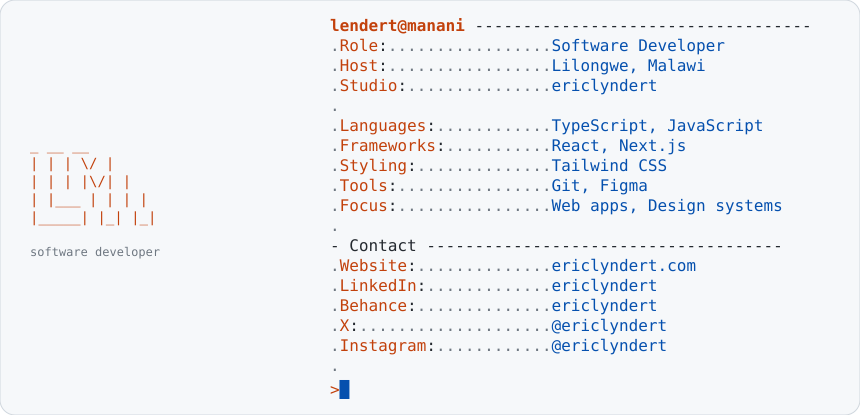

<a href="https://www.ericlyndert.com">
  <picture>
    <source media="(prefers-color-scheme: dark)" srcset="https://raw.githubusercontent.com/lyndertmanani/lyndertmanani/main/dark_mode.svg">
    
  </picture>
</a>

<a href="https://www.ericlyndert.com"><picture><source media="(prefers-color-scheme: dark)" srcset="https://raw.githubusercontent.com/lyndertmanani/lyndertmanani/main/link_website_dark.svg"></picture></a><a href="https://www.linkedin.com/in/ericlyndert"><picture><source media="(prefers-color-scheme: dark)" srcset="https://raw.githubusercontent.com/lyndertmanani/lyndertmanani/main/link_linkedin_dark.svg"></picture></a>

<picture>
  <source media="(prefers-color-scheme: dark)" srcset="https://raw.githubusercontent.com/lyndertmanani/lyndertmanani/output/github-snake-dark.svg">
  
</picture>
